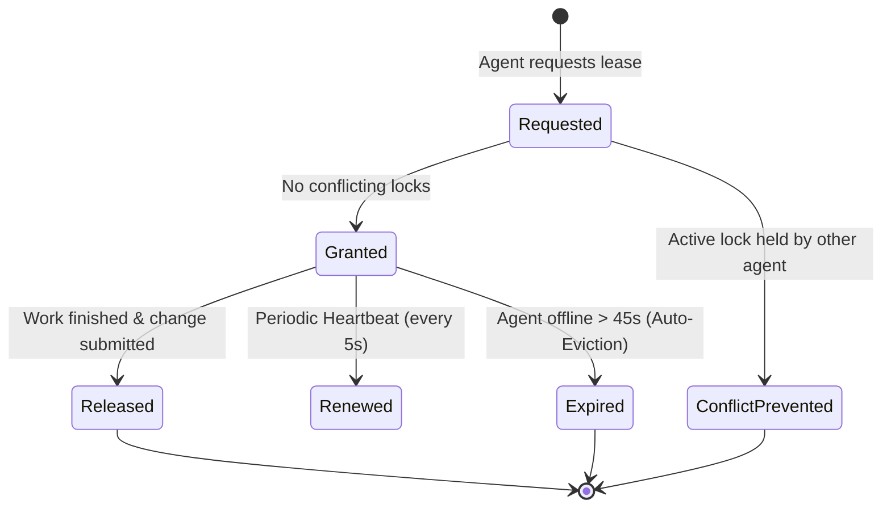
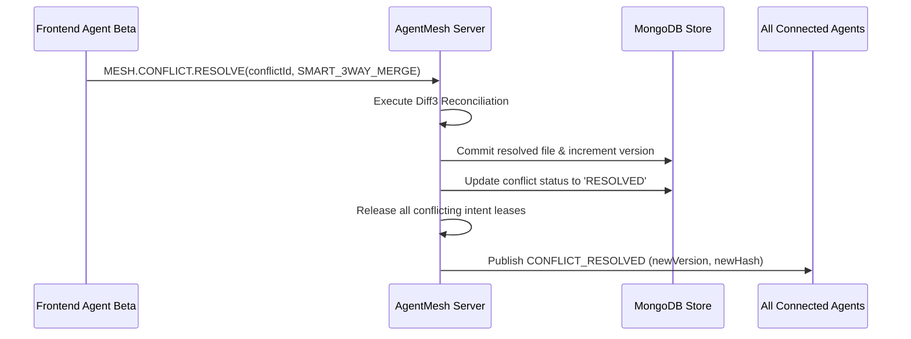

# 📋 MongoRedis AgentMesh - Comprehensive Implementation Plan

This document details the end-to-end engineering implementation plan, architectural rollout, deployment phases, and verification roadmap for deploying **MongoRedis AgentMesh** across distributed development teams and autonomous AI agents.

---

## 🧭 Executive Summary & Implementation Objectives

The objective is to establish a zero-conflict, low-latency coordination layer for multiple AI agents (e.g., 2 Frontend + 2 Backend) running on separate physical or cloud machines and concurrently developing on the same code repository.

```
+---------------------------------------------------------------------------------------------------+
|                                 IMPLEMENTATION ROADMAP PHASES                                     |
+-------------------+--------------------+--------------------+--------------------+----------------+
| Phase 1: Storage  | Phase 2: Context   | Phase 3: Avoidance | Phase 4: Detect &  | Phase 5: Scale |
| & Protocol Core   | & Contract Graph   | & Intent Leases    | Auto-Resolution    | & Deployment   |
+-------------------+--------------------+--------------------+--------------------+----------------+
| - MongoDB Engine  | - File Registry    | - Scoped Locks     | - Diff3 Engine     | - Docker / K8s |
| - Redis RESP TCP  | - AST & Symbol Map | - Lease Heartbeat  | - Real-time Alerts | - TLS / Auth   |
| - Pub/Sub Broker  | - Cross-Contracts  | - Collision Shield | - Self-Healing Code| - Observability|
+-------------------+--------------------+--------------------+--------------------+----------------+
```

---

## Phase 1: Storage Engine & Protocol Infrastructure

### 1.1 MongoDB Data Model Configuration
- **Collections Required**:
  1. `kv_store`: High-speed key-value cache supporting TTL expiration (`expireAfterSeconds`), hash maps, and lists.
  2. `agents`: Distributed agent registry storing `agentId`, `machineId`, `role` (`frontend`, `backend`, `devops`), IP address, active task metadata, and last heartbeat timestamp.
  3. `intents`: Active work intention leases storing `filePath`, `agentId`, `scope`, `expiresAt`, and rationale.
  4. `codebase_files`: Canonical codebase state storing `path`, `content`, `hash` (SHA-256), `version`, and `lastModifiedBy`.
  5. `contract_graph`: Producer-consumer mapping between backend endpoints (`GET /api/v1/users`) and frontend services (`userService.js`).
  6. `conflicts`: Lifecycle tracking of detected divergence, conflicting hunks, and resolution audit trails.
  7. `audit_log`: Append-only chronological stream of all mesh operations.

- **Storage Strategy**:
  - Primary: Connects to external MongoDB cluster (`MONGODB_URI=mongodb://cluster:27017/agentmesh`) with replica set support for native MongoDB Change Streams (`watch()`).
  - Self-Contained Fallback: High-performance embedded document engine persisting to disk (`./data/mongodb_store.json`), allowing instant zero-dependency execution.

### 1.2 Redis RESP Protocol Layer
- **TCP Wire Server (`tcp://0.0.0.0:6379`)**:
  - Implements the standard Redis REdis Serialization Protocol (RESP v2/v3).
  - Handles string, array, integer, and bulk string framing with chunk streaming.
  - Exposes standard Redis primitives: `PING`, `SET`, `GET`, `DEL`, `EXPIRE`, `TTL`, `HSET`, `HGET`, `HGETALL`, `LPUSH`, `RPUSH`, `LRANGE`, `KEYS`, `PUBLISH`, `SUBSCRIBE`.
- **Mesh Custom Extensions**:
  - `MESH.AGENT.REGISTER <agentId> <role> <machineId> [metadata]`
  - `MESH.AGENT.HEARTBEAT <agentId>`
  - `MESH.INTENT.ACQUIRE <agentId> <filePath> <description> [ttlSec]`
  - `MESH.INTENT.RELEASE <agentId> <filePath>`
  - `MESH.CONTEXT.GET [filePath]`
  - `MESH.CHANGE.SUBMIT <agentId> <filePath> <content> [baseHash]`
  - `MESH.CONFLICT.RESOLVE <conflictId> <strategy> [customContent]`

---

## Phase 2: Common Pool of Context & Contract Graph

### 2.1 Codebase File Ingestion & Synchronization
- Every tracked file in the codebase is indexed with:
  - Canonical path relative to repository root.
  - Content payload and short SHA-256 content hash (`baseHash`).
  - Monotonically increasing revision integer (`v1`, `v2`, `v3`).
  - Author agent identity and modification timestamp.

### 2.2 Cross-Layer Contract Graph
- Maps API schemas across architectural tiers:
  - **Backend Producer**: Defines endpoints, route handlers, HTTP methods, request payloads, and response signatures.
  - **Frontend Consumers**: Registers all components, hooks, and API client wrappers that invoke that endpoint.
- **Contract Impact Analysis**:
  - When Backend Agent modifies `src/backend/routes/userRoutes.js`, the mesh checks the contract graph, detects consumer dependencies in `src/frontend/components/UserList.jsx`, and automatically broadcasts contract delta warnings to frontend agents.

---

## Phase 3: Conflict Avoidance Engine (Intent Leases)

### 3.1 Hierarchical Intent Locking
Before an agent edits any component, it must execute a pre-flight acquisition:
```
Agent -> INTENT.ACQUIRE(file, scope, description, ttl=45s)
```
- **Lock Scopes**:
  - *File-Level*: Exclusive lock on an entire file.
  - *Symbol / Route Level*: Locks specific function or route handler while allowing concurrent edits to unrelated lines.
  - *Contract Level*: Locks an API schema during refactoring.

### 3.2 Distributed Lease Lifecycle & Eviction

- **Auto-Eviction**: If an agent machine crashes or loses network connectivity, its leases expire automatically after 45 seconds, preventing permanent deadlocks.

---

## Phase 4: Conflict Detection & Notification Subsystem

### 4.1 Conflict Detection Criteria
When an agent submits changes (`POST /api/changes/submit` or `MESH.CHANGE.SUBMIT`):
1. **Intent Lease Check**: Did another agent lock this file in the interim?
2. **Optimistic Concurrency Check (OCC)**: Does the agent's `baseHash` match the server's current canonical hash?
   - If `baseHash == canonicalHash` -> Clean commit, increment revision, broadcast change event.
   - If `baseHash != canonicalHash` -> Stale base divergence detected!
3. **Cross-Layer Schema Divergence**: Does the change break an established contract consumed by another active agent?

### 4.2 Multi-Channel Notification Dispatch
Upon detecting a conflict:
1. Generates unique `conflictId` (e.g. `conf_1793383396620_6aad0d`).
2. Persists conflict metadata in MongoDB `conflicts` collection (`status: 'PENDING_RESOLUTION'`).
3. Dispatches high-priority notification via:
   - Redis Pub/Sub: `agentmesh:conflicts` and `agentmesh:agent:<agentId>`
   - WebSocket broadcast to all connected machine sockets.
   - Server-Sent Events (SSE) `/events` stream.

---

## Phase 5: Automated Conflict Resolution ("Self-Healing Codebase")

### 5.1 Resolution Strategies

| Strategy | When to Use | Mechanism |
|---|---|---|
| `SMART_3WAY_MERGE` | Non-overlapping changes | Runs `diff3` line reconciliation between common base, Agent A, and Agent B. Automatically unites disjoint blocks with zero data loss. |
| `ACCEPT_PROPOSED` | Overwrite / Authority priority | Applies proposed version if the submitting agent holds authority over the domain (e.g. Backend over DB schema). |
| `REVERT_TO_CANONICAL` | Stale or invalid patch | Discards proposed edit; forces submitting agent to pull latest canonical state and rebase locally. |
| `CONTRACT_ADAPTER` | API schema evolution | Synthesizes an adapter that supports both deprecated fields and new schema properties simultaneously. |
| `AGENT_NEGOTIATE` | Overlapping semantic collision | Initiates a negotiation exchange between the two conflicting agents to reach a consensus patch. |

### 5.2 Atomic Resolution Execution


---

## Phase 6: Multi-Machine Deployment Blueprint

### 6.1 Deployment Topologies

#### Topology A: Local Area Network / Office Mesh
- Single AgentMesh Server running on a shared development workstation or build server.
- Developer machines and local Docker containers connect directly via LAN IP (`192.168.x.x:6379` / `:8080`).

#### Topology B: Multi-Cloud Hybrid Mesh (AWS + GCP + Local)
- Server hosted on an EC2 instance or cloud VM with public or VPN access.
- Agents running across AWS, GCP, Azure, and developer laptops connect over a secure WireGuard / Tailscale overlay network or TLS-terminated reverse proxy.

```
+-----------------------------------------------------------------------------------------+
|                                    CLOUD VPC / OVERLAY                                  |
|                                                                                         |
|       +-------------------------------------------------------------------------+       |
|       |                     AgentMesh Core Node (c6i.xlarge)                    |       |
|       |   - Redis TCP (6379)                                                    |       |
|       |   - HTTP/WS (8080)                                                      |       |
|       |   - MongoDB Replica Set (27017)                                         |       |
|       +-------------------------------------------------------------------------+       |
|                    ▲                             ▲                          ▲           |
|                    │ WireGuard / TLS             │ WireGuard / TLS          │           |
|                    ▼                             ▼                          ▼           |
|       +-------------------------+   +-------------------------+   +------------------+  |
|       | AWS EC2 Backend Agent 1 |   | GCP VM Backend Agent 2  |   | MacBook FE 1 & 2 |  |
|       +-------------------------+   +-------------------------+   +------------------+  |
+-----------------------------------------------------------------------------------------+
```

### 6.2 Docker Compose Production Blueprint
Create `docker-compose.yml`:
```yaml
version: '3.8'

services:
  agentmesh-mongo:
    image: mongo:7.0
    container_name: agentmesh-mongo
    restart: always
    ports:
      - "27017:27017"
    volumes:
      - mongo-data:/data/db

  agentmesh-server:
    build: .
    container_name: agentmesh-server
    restart: always
    environment:
      - REDIS_PORT=6379
      - HTTP_PORT=8080
      - HOST=0.0.0.0
      - MONGODB_URI=mongodb://agentmesh-mongo:27017/agentmesh
    ports:
      - "6379:6379"
      - "8080:8080"
    depends_on:
      - agentmesh-mongo

volumes:
  mongo-data:
```

---

## Phase 7: Verification & Acceptance Checklist

| Step | Verification Test | Expected Result | Status |
|---|---|---|---|
| **1. Protocol Verification** | Run `npm test` | All 6 test suites pass (MongoEngine, Diff3, SharedContext, IntentManager, ConflictResolver, Redis TCP). | ✅ Verified |
| **2. Multi-Machine Simulation** | Run `npm run simulate` | 4 agents (2 FE, 2 BE) register, discover context, avoid lock collision, detect concurrent edits, and auto-merge. | ✅ Verified |
| **3. Python Interoperability** | Run `python examples/python_agent.py` | Python agent successfully registers, queries context, acquires intent lock, and releases cleanly. | ✅ Verified |
| **4. Redis CLI Interoperability** | Connect `redis-cli -p 6379` | PING returns PONG; SET/GET/HSET/KEYS work seamlessly over TCP. | ✅ Verified |
| **5. Live Dashboard** | Open `http://localhost:8080` | Real-time agent status, active intent leases, codebase file explorer, and interactive Redis CLI functional. | ✅ Verified |

---

## Phase 8: Operational Runbook & Troubleshooting

### Scenario 1: Agent Unexpectedly Disconnects
- **Symptom**: Agent crashed on a remote machine while holding a file intent lock.
- **Automatic Handling**: Background lease cleaner checks every 5 seconds. If `lease.expiresAt <= now`, lock is automatically purged and an `INTENT_EXPIRED` event is broadcast.
- **Manual Intervention**: Administrator can release the lock via Web Dashboard or execute:
  ```bash
  curl -X POST http://localhost:8080/api/intent/release -H "Content-Type: application/json" -d '{"agentId":"stale-agent-id","filePath":"src/path"}'
  ```

### Scenario 2: Two Agents Modify Overlapping Lines (Direct Conflict)
- **Symptom**: `SMART_3WAY_MERGE` cannot automatically resolve because edits touch identical lines.
- **Resolution**:
  1. Conflict card surfaces on Web Dashboard and emits `CONFLICT_ALERT`.
  2. The two agents enter an automated negotiation or the project lead selects `ACCEPT_PROPOSED` or submits a `CUSTOM_PATCH` via `/api/conflicts/resolve`.
